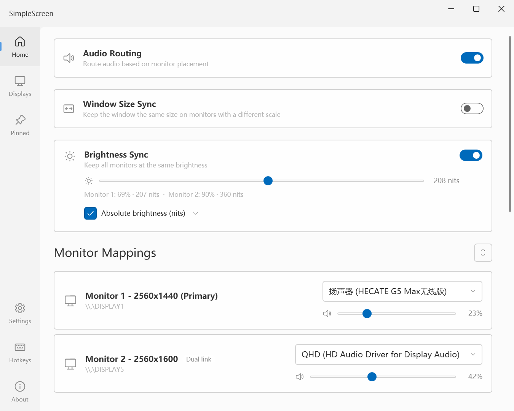
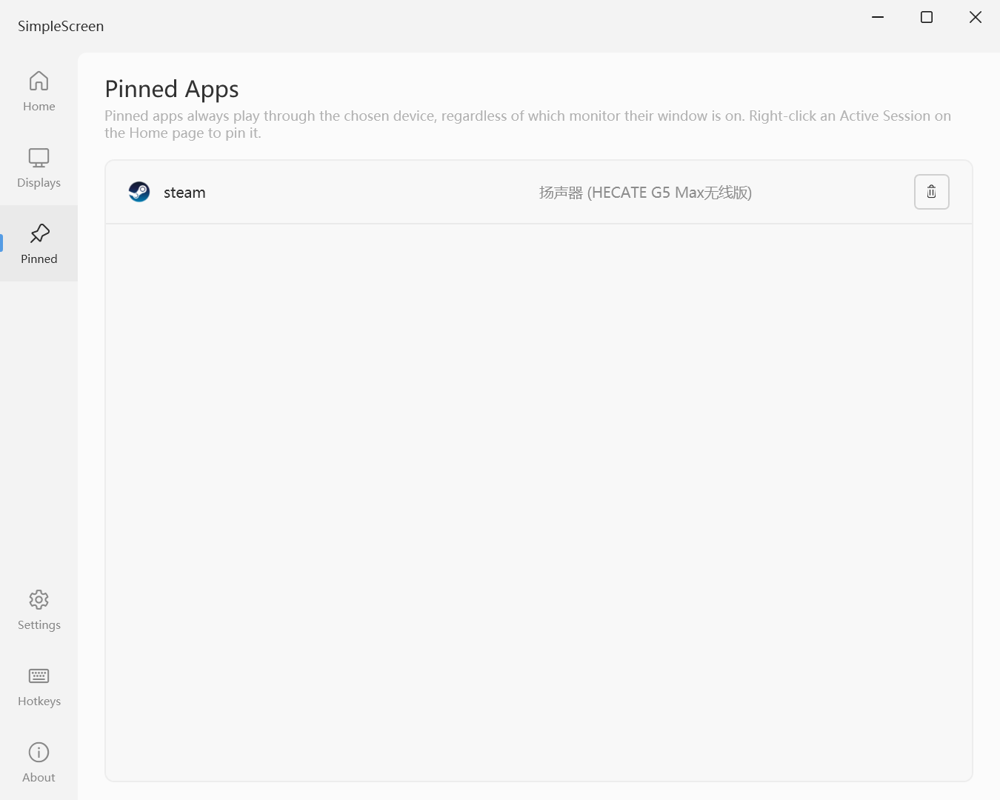
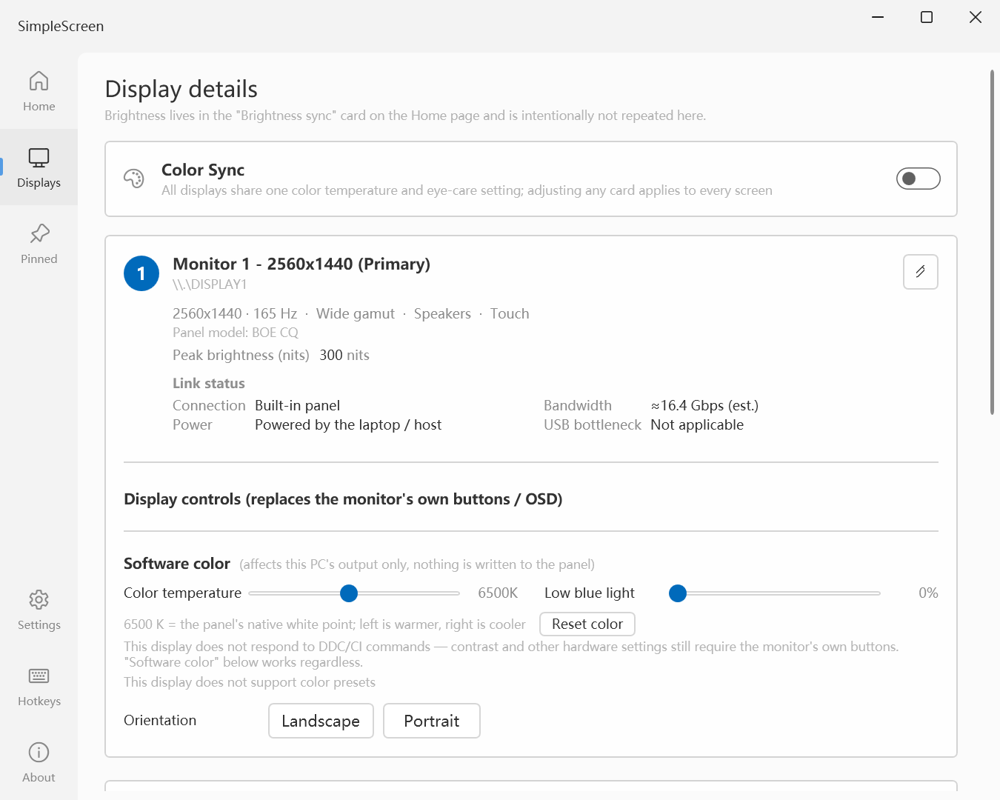
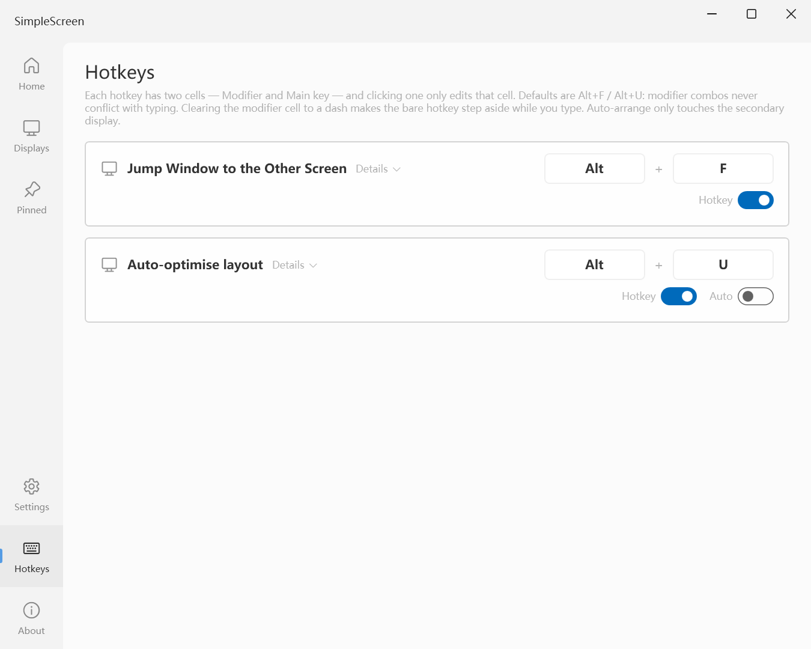
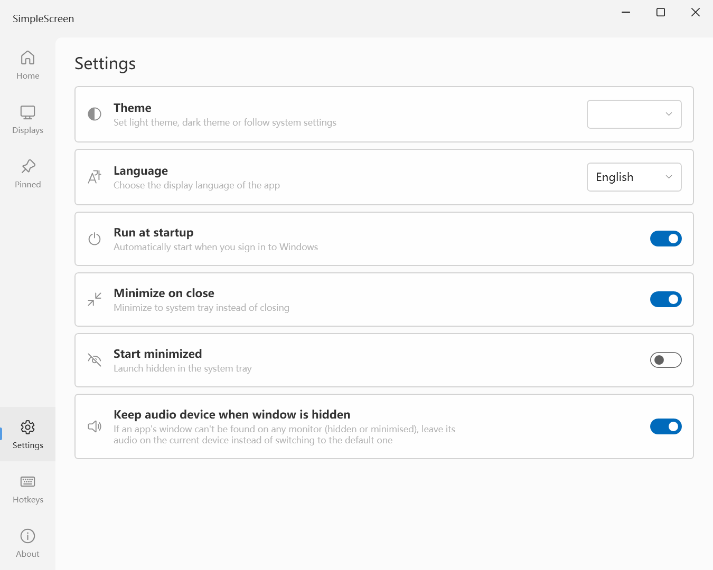
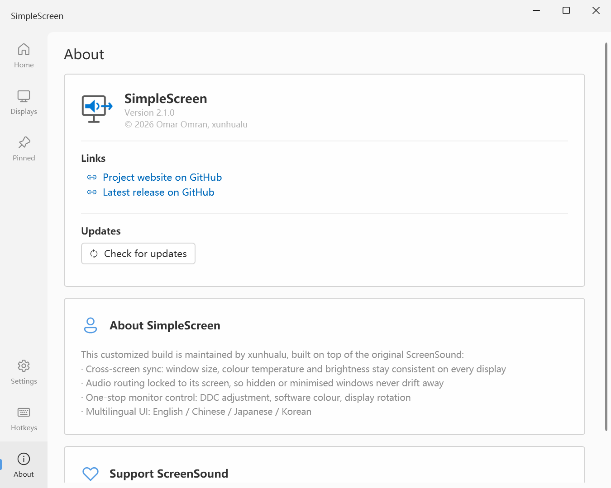

# SimpleScreen — Multi-Monitor & Display Control for Windows

**Sound, brightness and colour follow your windows.** A free, open-source **multi-screen** utility for **Windows** that routes each app's audio to the speaker paired with the monitor its window is on — and keeps window size, brightness and colour consistent across every **display**.

> 中文版见下方 [Chinese section](#simplescreen--windows-副屏--多屏管理工具)。

SimpleScreen is a customized fork of [ScreenSound](https://github.com/twibster/ScreenSound) (MIT, by Omar Omran), extended with monitor control, nit-based brightness sync and software colour adjustment. Think of it as one tray app for **dual monitor** and multi-display desks: **screen control**, audio routing and cross-screen sync in one place.



## The problem it solves

If you run more than one monitor on Windows, you already know these pains:

- **Sound comes out of the wrong speakers.** You drag a game or video to the second screen, but its audio keeps playing through the laptop speakers — or the other way around. Windows has no per-window audio routing.
- **Every screen looks different.** Two panels at the same "70% brightness" are not the same brightness. One is 300 nits, the other 160. Colours drift too.
- **Windows jump size between screens.** Drag a window from a 150% scaled display to a 200% one and it visibly shrinks or grows, even though it is "the same size".
- **The second monitor has no buttons.** Its brightness, input source, volume and colour preset are buried in an OSD menu you have to feel for behind the panel.

SimpleScreen fixes all four from a single tray app, without a driver and without touching your Windows display settings.

## How it is different from similar tools

| Tool | Per-window audio routing | Nit-based brightness sync across screens | Window size sync across DPI | Monitor DDC/CI control | Software colour (no DDC needed) |
| :--- | :---: | :---: | :---: | :---: | :---: |
| **SimpleScreen** | ✅ | ✅ | ✅ | ✅ | ✅ |
| DisplayFusion / UltraMon | ❌ | ❌ | ⚠️ window rules only | ❌ | ❌ |
| EarTrumpet / SoundVolumeView | ⚠️ manual switch | ❌ | ❌ | ❌ | ❌ |
| f.lux / Light Bulb | ❌ | ❌ | ❌ | ❌ | ⚠️ temperature only |
| ControlMyMonitor / ClickMonitorDDC | ❌ | ❌ | ❌ | ✅ single screen | ❌ |

Most tools solve **one** slice of the multi-monitor problem. EarTrumpet switches audio but you do it by hand. f.lux shifts colour temperature but knows nothing about your panels. ControlMyMonitor talks DDC/CI but only to one screen at a time. SimpleScreen ties them together: **audio follows the window, and the desk stays visually consistent.**

## Features

### Audio routing (inherited from ScreenSound)
- Routes each app's audio to the audio device paired with the monitor its window sits on.
- **Pinned apps**: lock an app to a specific device regardless of where its window moves.
- Hidden or minimised windows keep their audio on the last screen they occupied — drift is detected and pulled back.
- Tray mode, autostart, English / 简体中文 / 日本語 / 한국어 UI.



### Added in this fork
- **Nit-based brightness sync** — absolute brightness alignment across panels with different peak nits (DDC/CI + WMI fallback). Set one value in nits, every screen matches it.
- **Window size sync** — keeps a window the same *physical* size when dragged between monitors with different DPI scales (Windows normally keeps the logical size, so the window jumps).
- **Colour sync** — one colour temperature / eye-care setting for the whole desk; editing it on any monitor's card applies it to every screen.
- **Monitor details page** — auto-detected DDC controls: contrast, speaker volume, mute, input source, colour preset, RGB gain, panel model, peak nits, link bandwidth.
- **Software colour** — 4000–9300 K colour temperature and low-blue-light eye care via gamma ramp; works even on panels without DDC support, and is restored when the app exits.
- **Display rotation** — portrait/landscape switching through the Windows display configuration API, identical to the system setting.
- **Hotkeys** — `Alt + F` jumps the focused window to the other screen; `Alt + U` auto-arranges windows on the secondary display. Both are rebindable, with modifier combos that never collide with typing.
- **Dual-link merge** — a portable screen connected over both HDMI and Type-C is shown as one monitor, not two.
- **Robust DDC bus** — serialized transactions with retries, so a panel wired over two cables is no longer misdetected.









## Requirements

- Windows 10 1809+ / Windows 11, x64
- [.NET 8 Desktop Runtime](https://dotnet.microsoft.com/download/dotnet/8.0) (the installer offers to download it automatically)
- A DDC/CI-capable external monitor for hardware controls (audio routing and software colour work without it)

## Installation

Download the latest release from the [Releases](https://github.com/xunhualu/SimpleScreen/releases) page:

- **SimpleScreen-Setup-x.y.z.exe** — installer (recommended)
- **SimpleScreen-x.y.z-portable.zip** — portable build, unpack and run `SimpleScreen.exe`

## Building from source

```powershell
git clone https://github.com/xunhualu/SimpleScreen.git
cd SimpleScreen
dotnet restore ScreenSound.sln
dotnet publish ScreenSound\ScreenSound.csproj -c Release -r win-x64 --self-contained false -o publish
```

The Inno Setup script in `installer/` builds the setup exe from the `publish/` folder.

## How it works

- Window positions are tracked via `SetWinEventHook` (move/resize end, foreground change) plus a heartbeat; audio sessions are moved between endpoints with the `IPolicyConfig` COM interface.
- Monitor control uses DDC/CI (`dxva2.dll`) with a global bus lock and retry, falling back to WMI brightness for laptop panels.
- Software colour is a per-display GDI gamma ramp, applied on startup if saved and restored to identity on exit. Physical screen size is read from EDID, with corrections for panels that report a wrong size.

## License

MIT — see [LICENSE](LICENSE). Original ScreenSound © Omar Omran; SimpleScreen modifications © xunhualu.

---

# SimpleScreen — Windows 副屏 / 多屏管理工具

**声音、亮度和色彩跟着窗口走。** SimpleScreen 是一款免费开源的 **Windows 多屏** 工具：把每个程序的声音自动送到它窗口所在屏幕对应的音箱，并让窗口大小、亮度、色彩在每一块 **显示器** 上保持一致。适用于 **双屏** 或更多屏幕的桌面。


## 它解决什么麻烦

- **声音跑错音箱。** 把游戏或视频拖到副屏，声音却还从笔记本喇叭出来。Windows 本身不支持按窗口路由音频。
- **两块屏看起来不一样。** 同样"70% 亮度"其实差很多——一块 300 尼特，一块 160 尼特，色彩也各不一样。
- **窗口跨屏就变大小。** 从 150% 缩放的屏拖到 200% 的屏，窗口忽大忽小。
- **副屏没有实体按键。** 亮度、输入源、音量、色彩预设都藏在显示器背后的 OSD 菜单里。

SimpleScreen 用一个托盘程序解决这四件事，无需驱动、不改系统显示设置。

## 和同类软件有什么不同

多数工具只解决多屏问题的**一个切面**：EarTrumpet 能切音频但要手动；f.lux 调色温却不懂你的面板；ControlMyMonitor 能控 DDC 但一次只能一块屏。SimpleScreen 把它们串起来——**音频跟着窗口走，整桌显示保持一致**。详见上方 [英文对比表](#how-it-is-different-from-similar-tools)。

## 功能

- **按窗口位置路由音频**，可为单个程序固定输出设备；隐藏/最小化窗口的音频不会漂移。
- **按尼特同步亮度**：不同峰值亮度的屏幕对齐到同一个绝对亮度。
- **窗口大小同步**：跨不同 DPI 缩放的屏幕拖动时，保持物理尺寸一致。
- **色彩同步**：整桌共用一个色温/护眼设置，在任意屏幕卡片上改，所有屏一起生效。
- **显示器详情**：DDC 硬件控制（对比度、音量、静音、输入源、色彩预设、RGB）、面板型号、峰值亮度、链路带宽诊断。
- **软件色彩**：4000–9300K 色温与低蓝光，走 gamma ramp，没有 DDC 的屏幕也能用，退出时自动还原。
- **屏幕旋转**、**快捷键**（Alt+F 投到另一屏 / Alt+U 自动整理副屏窗口）、**HDMI+Type-C 双线合并为一台屏**。
- 托盘常驻、开机自启，支持简体中文 / English / 日本語 / 한국어。

## 安装

从 [Releases](https://github.com/xunhualu/SimpleScreen/releases) 下载：

- **SimpleScreen-Setup-x.y.z.exe** — 安装包（推荐）
- **SimpleScreen-x.y.z-portable.zip** — 免安装版，解压运行 `SimpleScreen.exe`

环境要求：Windows 10 1809+ / Windows 11 x64，需 [.NET 8 桌面运行时](https://dotnet.microsoft.com/download/dotnet/8.0)。硬件 DDC 控制需要支持 DDC/CI 的外接显示器（音频路由和软件色彩不需要）。

## 许可

MIT — 见 [LICENSE](LICENSE)。原始 ScreenSound © Omar Omran；SimpleScreen 修改部分 © xunhualu。
